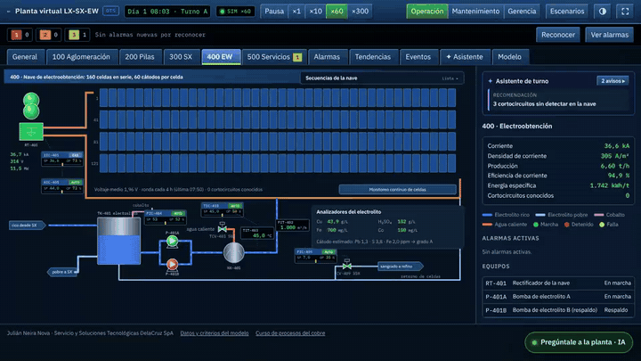
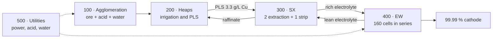
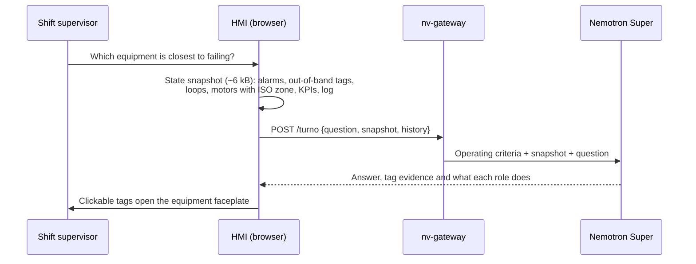

# Virtual Plant LX-SX-EW

**Operator training simulator (OTS) for a heap leach, solvent extraction and electrowinning copper plant. SCADA-style control room, PID loops, ISA-18.2 alarms, sequences, ISO 20816-3 vibration and an NVIDIA-powered assistant that reads the live plant. Runs in the browser.**

[](https://jsnn15.github.io/planta-virtual/)


[Español](README.md) · **English**

> The interface is in Spanish.

<a href="https://jsnn15.github.io/planta-virtual/"></a>

## What it is for

When equipment fails, the operator, the maintainer and the plant manager need different information, yet they all stare at the same alarm list. This plant lets you practice startups, shutdowns and faults without risk, and shows how each role sees the same fault.

## The plant





## Features

- **Live P&IDs** for the five areas in two styles: classic mine SCADA (colored pipes with animated flow) and high-performance ISA-101 (grey, color only for abnormal).
- **Faceplates** with two-step commands, manual/auto/cascade modes, alarm limits and 30-min trends.
- **Sequences (simplified ISA-106)**: area 100 start/stop, EW tankhouse commissioning with a 2 kA/min ramp, and shutdown to protection current.
- **ISA-18.2 alarms**: priorities, acknowledge, shelving and state-based suppression.
- **Local shift assistant**: upcoming alarms (20-min regression), likely root cause of an alarm flood, and alarm-less anomalies (z-score vs. 2 h).
- **Maintenance and management views**: vibration, predictive warnings, shift KPIs and valued losses.
- **Trends, event log and 8-h historian**, exportable to CSV.

## Ask the plant (NVIDIA AI)



The model gets explicit operating criteria (vibration zone C = schedule the intervention, zone D = controlled stop; EW short circuits are cleared while running) and only the current data. If something is not in the data, it says so.

## What it is and is not

A **digital model** (Kritzinger et al., 2018): it exchanges no data with a real plant. Parameters come from the literature (ENAMI, Sole et al., Faraday's law, LME) and copper, acid and water balances close, but values do not represent any specific operation. The engineering and metallurgy review is in [`REVISION.md`](REVISION.md) (Spanish).

| Level | Data with the plant | What is missing |
|---|---|---|
| Digital model | None | Current level |
| Digital shadow | Plant → model | Read the historian (OPC UA or PI) and fit parameters |
| Digital twin | Both ways | Also send back recommendations or setpoints |

## Standards

| Standard | In this simulator |
|---|---|
| ANSI/ISA-18.2 · IEC 62682 | Applied: priorities, states, shelving, state-based suppression |
| ANSI/ISA-101.01 | Partial: alternate high-performance style |
| ANSI/ISA-5.1 | Partial: ISA-5.1 tags, simplified symbols |
| ISA-106 | Partial: area 100 and 400 sequences |
| ISO 20816-3 | Applied: zones A to D by machine group |
| IEEE 519 | Partial: 12-pulse rectifier harmonics |
| BS EN 1978 (LME grade A) | Applied: Pb, S and Fe cathode limits |
| IEC 61511 · ISA/IEC 62443 · IEC 62541 | Reference for a real plant |

## Files

| File | What it is |
|---|---|
| `sim.js` | 1-s step engine: balances, PID, interlocks, sequences, alarms and historian. Browser-independent. |
| `hmi.js` | Operations, maintenance and management UI. |
| `asistente.js` | Ask the plant: builds the state snapshot and renders the answer with clickable tags. |
| `test/sim.test.js` | 13 tests: design steady state, Faraday, scenarios, sequences, alarm suppression, vibration zones and 72-h stability. |
| `REVISION.md` | Engineering and metallurgy review of the model. |

```bash
node test/sim.test.js
```

---

<sub>Personal project by **Julián Neira Nova**, electrical engineer with 10 years in mining operations · Servicio y Soluciones Tecnológicas DelaCruz SpA. Nothing here comes from clients or employers.
[Portfolio](https://jsnn15.github.io/) · [LinkedIn](https://www.linkedin.com/in/julian-neira-nova/) · [All tools](https://github.com/JSNN15)</sub>
