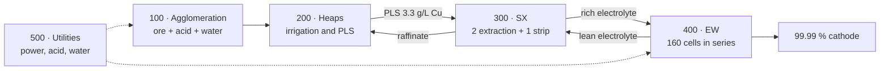

# Virtual Plant LX-SX-EW

**Operator training simulator (OTS) for a heap leach, solvent extraction and electrowinning copper plant. SCADA-style control room, PID loops, ISA-18.2 alarms, sequences, ISO 20816-3 vibration and an industrial AI assistant (NVIDIA Nemotron) that diagnoses with evidence, proposes actions from a closed catalog and only acts with human approval. Runs in the browser.**

[](https://jsnn15.github.io/planta-virtual/)


[Español](README.md) · **English**

> The interface is in Spanish.

<a href="https://jsnn15.github.io/planta-virtual/"></a>

## What it is for

When equipment fails, the operator, the maintainer and the plant manager need different information, yet they all stare at the same alarm list. This plant lets you practice startups, shutdowns and faults without risk, and shows how each role sees the same fault.

## The plant




Simplified P&ID with the main loops (ISA-5.1). The full explanation of process, control and AI is in [`docs/ARQUITECTURA.md`](docs/ARQUITECTURA.md) (Spanish):


## Features

- **Live P&IDs** for the five areas in two styles: classic mine SCADA (colored pipes with animated flow) and high-performance ISA-101 (grey, color only for abnormal).
- **Faceplates** with two-step commands, manual/auto/cascade modes, alarm limits and 30-min trends.
- **Sequences (simplified ISA-106)**: area 100 start/stop, EW tankhouse commissioning with a 2 kA/min ramp, and shutdown to protection current.
- **ISA-18.2 alarms**: priorities, acknowledge, shelving and state-based suppression.
- **Full process**: crusher CR-101 with liner wear and P80, heap solution retention (PLS responds over days), W1 wash stage controlling chloride and iron in the electrolyte, rich and lean electrolyte, tankhouse current set by the production plan (copper balance and Faraday) and harvest by lots every 7 days with BS EN 1978 quality.
- **Shift assistant**: upcoming alarms (20-min regression), likely root cause of an alarm flood, alarm-less anomalies and recommendations. Each warning carries its action, «Why» and «How» (the manual procedure).
- **Knowledge base and manuals**: ISA-18.2 alarm master database, action catalog, physical, chemical and safety rules, and operations, maintenance, management and assistant manuals with 37 citable sections.
- **Maintenance and management views**: vibration, predictive warnings, shift KPIs, valued losses, editable plan and price, harvest lots.
- **Trends, event log and 8-h historian**, exportable to CSV.

## Industrial AI assistant (NVIDIA Nemotron)


Each question, or the «Why» button on a warning, goes through a seven-stage pipeline:

1. **Understand** with Nemotron Lightning: intent, equipment and what to query.
2. **Query** the plant with read-only tools and search the manuals.
3. **Diagnose** with Nemotron Super and a strict JSON schema: cause, evidence, catalog actions, manual steps and what it does not know.
4. **Verify** in code: every tag exists, every value is the real one, every action is in the catalog and meets its preconditions and hard rules S1 to S9.
5. **Re-analyze** once if the model made up data or actions.
6. **Propose** action cards that a person approves in two steps, with their role. What the assistant cannot do (reset after a protection trip, close a breaker) it teaches from the manual.
7. **Follow up**: checks that the action had the expected effect and logs it.

Offline, the same pipeline answers with the **rule-based diagnosis** in `ia-nucleo.js`, with the same verification. It runs at **autonomy level 2**: it proposes and executes only with human approval.


## What it is and is not

A **digital model** (Kritzinger et al., 2018): it exchanges no data with a real plant. Parameters come from the literature (ENAMI, Sole et al., Faraday's law, LME) and copper, acid and water balances close, but values do not represent any specific operation. The engineering and metallurgy review is in [`REVISION.md`](REVISION.md) (Spanish).

| Level          | Data with the plant | What is missing                                      |
| -------------- | ------------------- | ---------------------------------------------------- |
| Digital model  | None                | Current level                                        |
| Digital shadow | Plant → model       | Read the historian (OPC UA or PI) and fit parameters |
| Digital twin   | Both ways           | Also send back recommendations or setpoints          |

## Standards

| Standard                              | In this simulator                                              |
| ------------------------------------- | -------------------------------------------------------------- |
| ANSI/ISA-18.2 · IEC 62682             | Applied: priorities, states, shelving, state-based suppression |
| ANSI/ISA-101.01                       | Partial: alternate high-performance style                      |
| ANSI/ISA-5.1                          | Partial: ISA-5.1 tags, simplified symbols                      |
| ISA-106                               | Partial: area 100 and 400 sequences                            |
| ISO 20816-3                           | Applied: zones A to D by machine group                         |
| IEEE 519                              | Partial: 12-pulse rectifier harmonics                          |
| BS EN 1978 (LME grade A)              | Applied: Pb, S and Fe cathode limits                           |
| IEC 61511 · ISA/IEC 62443 · IEC 62541 | Reference for a real plant                                     |

## Files

| File                          | What it is                                                                                                                                 |
| ----------------------------- | ------------------------------------------------------------------------------------------------------------------------------------------ |
| `sim.js`                      | 1-s step engine: balances, PID, interlocks, sequences, alarms and historian. Browser-independent.                                          |
| `hmi.js`                      | Operations, maintenance and management UI.                                                                                                 |
| `ia-nucleo.js`                | Assistant core, UI-free: rule-based monitoring, query tools, local diagnosis, verifier, role-based approval and follow-up.                 |
| `asistente.js`                | Assistant panel: pipeline through the `/planta` gateway route, action cards, manual viewer and per-answer trace.                           |
| `conocimiento/`               | Alarm master database, action catalog, physical, chemical and safety rules, plant model, tags and cause-effect.                            |
| `manuales/`                   | Operations, maintenance, management and assistant manuals (Spanish).                                                                       |
| `docs/ARQUITECTURA.md`        | Process, control, Purdue, inference pipeline and principles for adding AI to a plant (Spanish).                                            |
| `test/sim.test.js`            | 13 engine tests: design steady state, Faraday, scenarios, sequences, alarm suppression, vibration zones and 72-h stability.                |
| `test/ia.test.js`             | 18 AI and new-process tests: knowledge base consistency, verifier, rules S2, S6, S8 and S9, follow-up, 13-scenario bank and manual search. |
| `herramientas/evaluar-ia.mjs` | Scores the diagnosis (rule-based and, with `NV_URL`, Nemotron) against the scenario bank.                                                  |
| `REVISION.md`                 | Engineering and metallurgy review of the model.                                                                                            |

```bash
node test/sim.test.js && node test/ia.test.js
node herramientas/evaluar-ia.mjs          # 13/13 with the rule-based diagnosis
```

---

<sub>Personal project by **Julián Neira Nova**, electrical engineer with 10 years in mining operations · Servicio y Soluciones Tecnológicas DelaCruz SpA. Nothing here comes from clients or employers.
[Portfolio](https://jsnn15.github.io/) · [LinkedIn](https://www.linkedin.com/in/julian-neira-nova/) · [All tools](https://github.com/JSNN15)</sub>
