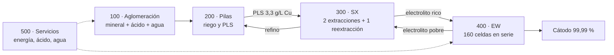

# Planta virtual LX-SX-EW

**Simulador de entrenamiento de operadores (OTS) de una planta de cobre por lixiviación en pilas, extracción por solventes y electroobtención. Sala de control tipo SCADA, lazos PID, alarmas ISA-18.2, secuencias, vibraciones ISO 20816-3 y un asistente de IA industrial (NVIDIA Nemotron) que diagnostica con evidencia, propone acciones de un catálogo cerrado y solo actúa con aprobación humana. Corre en el navegador.**

[](https://jsnn15.github.io/planta-virtual/)


**Español** · [English](README.en.md)

<a href="https://jsnn15.github.io/planta-virtual/"></a>

## Para qué sirve

Cuando falla un equipo, el operador, el mantenedor y el jefe de planta necesitan información distinta, pero todos miran la misma lista de alarmas. Esta planta permite practicar partidas, paradas y fallas sin riesgo, y muestra cómo cada rol ve la misma falla.

## La planta




El P&ID simplificado con los lazos principales (ISA-5.1), y la explicación completa del proceso, el control y la IA en [`docs/ARQUITECTURA.md`](docs/ARQUITECTURA.md):


## Qué tiene

- **P&ID en vivo** de las cinco áreas en dos estilos: clásico de faena (cañerías de color con flujo animado) y alto desempeño ISA-101 (gris, color solo para lo anormal).
- **Faceplates** con órdenes en dos pasos, modos manual, automático y cascada, límites de alarma y tendencia de 30 min.
- **Secuencias (ISA-106 simplificado)**: partida y parada del área 100, puesta en servicio de la nave EW con rampa de 2 kA/min y parada a corriente de protección.
- **Alarmas ISA-18.2**: prioridades, reconocimiento, inhibición y supresión por estado de equipo.
- **Proceso completo**: chancador CR-101 con desgaste de revestimientos y P80, retención de solución en la pila (el PLS responde en días), lavado W1 que controla el cloruro y el hierro del electrolito, electrolito rico y pobre, corriente de la nave por plan de producción (balance de cobre y Faraday) y cosecha por lotes cada 7 días con calidad BS EN 1978.
- **Asistente de turno**: alarmas que vienen (regresión de 20 min), causa probable de una avalancha, anomalías sin alarma y recomendaciones. Cada aviso trae su acción, «Por qué» y «Cómo» (el procedimiento del manual).
- **Base de conocimiento y manuales**: base maestra de alarmas ISA-18.2, catálogo de acciones, reglas físicas, químicas y de seguridad, y manuales de operación, mantenimiento, gerencia y del asistente con 37 secciones citables.
- **Vistas de mantenimiento y gerencia**: vibraciones, avisos predictivos, KPI de turno, pérdidas valorizadas, plan y precio editables, cosechas por lote.
- **Tendencias, bitácora e historiador de 8 h**, exportables a CSV.

## Asistente de IA industrial (NVIDIA Nemotron)


Cada pregunta, o el botón «Por qué» de un aviso, recorre un pipeline de siete etapas:

1. **Entender** con Nemotron Lightning: intención, equipos y qué consultar.
2. **Consultar** la planta con herramientas de solo lectura y buscar en los manuales.
3. **Diagnosticar** con Nemotron Super y esquema JSON estricto: causa, evidencia, acciones del catálogo, pasos del manual y lo que no sabe.
4. **Verificar** en código: cada tag existe, cada valor es el real, cada acción está en el catálogo y cumple sus precondiciones y las reglas duras S1 a S9.
5. **Reanalizar** una vez si el modelo inventó datos o acciones.
6. **Proponer** tarjetas de acción que una persona aprueba en dos pasos, con su rol. Lo que el asistente no puede hacer (rearmar tras una protección, cerrar un interruptor) lo enseña con el manual.
7. **Seguimiento**: vigila que la acción tenga el efecto esperado y lo anota en la bitácora.

Sin conexión, el mismo pipeline responde con el **diagnóstico por reglas** de `ia-nucleo.js`, con la misma verificación. Opera en **nivel 2 de autonomía**: propone y ejecuta solo con aprobación humana.


## Qué es y qué no es

Es un **modelo digital** (Kritzinger y otros, 2018): no intercambia datos con una planta real. Los parámetros vienen de literatura (ENAMI, Sole y otros, ley de Faraday, LME) y los balances de cobre, ácido y agua cierran, pero los valores no representan a ninguna operación. La revisión de ingeniería y metalurgia está en [`REVISION.md`](REVISION.md).

| Nivel          | Datos con la planta | Qué falta                                              |
| -------------- | ------------------- | ------------------------------------------------------ |
| Modelo digital | Ninguno             | Nivel actual                                           |
| Sombra digital | Planta → modelo     | Leer el historiador (OPC UA o PI) y ajustar parámetros |
| Gemelo digital | En ambos sentidos   | Además, devolver recomendaciones o consignas           |

## Normativa

| Norma                                 | En este simulador                                                |
| ------------------------------------- | ---------------------------------------------------------------- |
| ANSI/ISA-18.2 · IEC 62682             | Aplicada: prioridades, estados, inhibición, supresión por estado |
| ANSI/ISA-101.01                       | Parcial: estilo alternativo de alto desempeño                    |
| ANSI/ISA-5.1                          | Parcial: tags según ISA-5.1, símbolos simplificados              |
| ISA-106                               | Parcial: secuencias de las áreas 100 y 400                       |
| ISO 20816-3                           | Aplicada: zonas A a D por grupo de máquina                       |
| IEEE 519                              | Parcial: armónicos del rectificador de 12 pulsos                 |
| BS EN 1978 (LME grado A)              | Aplicada: límites de Pb, S y Fe en el cátodo                     |
| IEC 61511 · ISA/IEC 62443 · IEC 62541 | Referencia para una planta real                                  |

## Archivos

| Archivo                       | Qué es                                                                                                                                                                             |
| ----------------------------- | ---------------------------------------------------------------------------------------------------------------------------------------------------------------------------------- |
| `sim.js`                      | Motor con paso de 1 s: balances, PID, enclavamientos, secuencias, alarmas e historiador. No depende del navegador.                                                                 |
| `hmi.js`                      | Interfaz de operación, mantenimiento y gerencia.                                                                                                                                   |
| `ia-nucleo.js`                | Núcleo del asistente, sin interfaz: vigilancia por reglas, herramientas de consulta, diagnóstico local, verificador, aprobación por rol y seguimiento.                             |
| `asistente.js`                | Panel del asistente: pipeline con el intermediario `/planta`, tarjetas de acción, visor de manuales y trazabilidad de cada respuesta.                                              |
| `conocimiento/`               | Base maestra de alarmas, catálogo de acciones, reglas físicas, químicas y de seguridad, modelo de la planta, tags y causa-efecto.                                                  |
| `manuales/`                   | Manuales de operación, mantenimiento, gerencia y del asistente.                                                                                                                    |
| `docs/ARQUITECTURA.md`        | Proceso, control, Purdue, pipeline de inferencia y principios para sumar IA a una planta.                                                                                          |
| `test/sim.test.js`            | 13 pruebas del motor: régimen de diseño, Faraday, escenarios, secuencias, supresión de alarmas, zonas de vibración y estabilidad a 72 h.                                           |
| `test/ia.test.js`             | 18 pruebas de la IA y del proceso nuevo: consistencia de la base de conocimiento, verificador, reglas S2, S6, S8 y S9, seguimiento, banco de 13 escenarios y búsqueda en manuales. |
| `herramientas/evaluar-ia.mjs` | Evalúa el diagnóstico (por reglas y, con `NV_URL`, con Nemotron) contra el banco de escenarios.                                                                                    |
| `REVISION.md`                 | Revisión de ingeniería y metalurgia del modelo.                                                                                                                                    |

```bash
node test/sim.test.js && node test/ia.test.js
node herramientas/evaluar-ia.mjs          # 13/13 con el diagnóstico por reglas
```

---

<sub>Proyecto personal de **Julián Neira Nova**, ingeniero eléctrico con 10 años en faena · Servicio y Soluciones Tecnológicas DelaCruz SpA. Nada de lo publicado proviene de clientes ni de empleadores.
[Portafolio](https://jsnn15.github.io/) · [LinkedIn](https://www.linkedin.com/in/julian-neira-nova/) · [Todas las máquinas](https://github.com/JSNN15)</sub>
