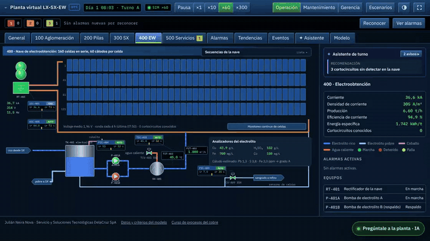
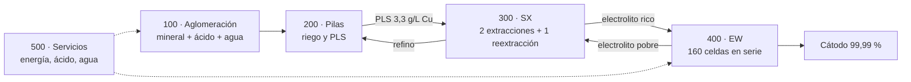
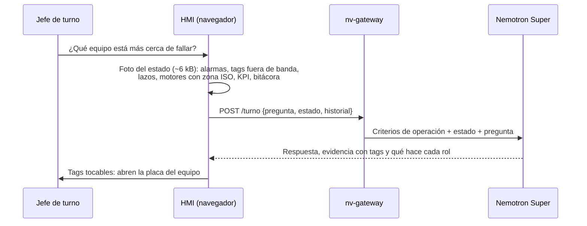

# Planta virtual LX-SX-EW

**Simulador de entrenamiento de operadores (OTS) de una planta de cobre por lixiviación en pilas, extracción por solventes y electroobtención. Sala de control tipo SCADA, lazos PID, alarmas ISA-18.2, secuencias, vibraciones ISO 20816-3 y un asistente con IA de NVIDIA que lee la planta en vivo. Corre en el navegador.**

[](https://jsnn15.github.io/planta-virtual/)


**Español** · [English](README.en.md)

<a href="https://jsnn15.github.io/planta-virtual/"></a>

## Para qué sirve

Cuando falla un equipo, el operador, el mantenedor y el jefe de planta necesitan información distinta, pero todos miran la misma lista de alarmas. Esta planta permite practicar partidas, paradas y fallas sin riesgo, y muestra cómo cada rol ve la misma falla.

## La planta





## Qué tiene

- **P&ID en vivo** de las cinco áreas en dos estilos: clásico de faena (cañerías de color con flujo animado) y alto desempeño ISA-101 (gris, color solo para lo anormal).
- **Faceplates** con órdenes en dos pasos, modos manual, automático y cascada, límites de alarma y tendencia de 30 min.
- **Secuencias (ISA-106 simplificado)**: partida y parada del área 100, puesta en servicio de la nave EW con rampa de 2 kA/min y parada a corriente de protección.
- **Alarmas ISA-18.2**: prioridades, reconocimiento, inhibición y supresión por estado de equipo.
- **Asistente de turno local**: alarmas que vienen (regresión de 20 min), causa probable de una avalancha y anomalías sin alarma (puntaje z contra 2 h).
- **Vistas de mantenimiento y gerencia**: vibraciones, avisos predictivos, KPI de turno y pérdidas valorizadas.
- **Tendencias, bitácora e historiador de 8 h**, exportables a CSV.

## Pregúntale a la planta (IA de NVIDIA)



El modelo recibe criterios de operación explícitos (zona C de vibración = programar la intervención, zona D = detener en forma controlada; los cortocircuitos en EW se corrigen en operación) y solo los datos del momento. Si algo no está en los datos, lo dice.

## Qué es y qué no es

Es un **modelo digital** (Kritzinger y otros, 2018): no intercambia datos con una planta real. Los parámetros vienen de literatura (ENAMI, Sole y otros, ley de Faraday, LME) y los balances de cobre, ácido y agua cierran, pero los valores no representan a ninguna operación. La revisión de ingeniería y metalurgia está en [`REVISION.md`](REVISION.md).

| Nivel | Datos con la planta | Qué falta |
|---|---|---|
| Modelo digital | Ninguno | Nivel actual |
| Sombra digital | Planta → modelo | Leer el historiador (OPC UA o PI) y ajustar parámetros |
| Gemelo digital | En ambos sentidos | Además, devolver recomendaciones o consignas |

## Normativa

| Norma | En este simulador |
|---|---|
| ANSI/ISA-18.2 · IEC 62682 | Aplicada: prioridades, estados, inhibición, supresión por estado |
| ANSI/ISA-101.01 | Parcial: estilo alternativo de alto desempeño |
| ANSI/ISA-5.1 | Parcial: tags según ISA-5.1, símbolos simplificados |
| ISA-106 | Parcial: secuencias de las áreas 100 y 400 |
| ISO 20816-3 | Aplicada: zonas A a D por grupo de máquina |
| IEEE 519 | Parcial: armónicos del rectificador de 12 pulsos |
| BS EN 1978 (LME grado A) | Aplicada: límites de Pb, S y Fe en el cátodo |
| IEC 61511 · ISA/IEC 62443 · IEC 62541 | Referencia para una planta real |

## Archivos

| Archivo | Qué es |
|---|---|
| `sim.js` | Motor con paso de 1 s: balances, PID, enclavamientos, secuencias, alarmas e historiador. No depende del navegador. |
| `hmi.js` | Interfaz de operación, mantenimiento y gerencia. |
| `asistente.js` | Pregúntale a la planta: arma la foto del estado y muestra la respuesta con tags tocables. |
| `test/sim.test.js` | 13 pruebas: régimen de diseño, Faraday, escenarios, secuencias, supresión de alarmas, zonas de vibración y estabilidad a 72 h. |
| `REVISION.md` | Revisión de ingeniería y metalurgia del modelo. |

```bash
node test/sim.test.js
```

---

<sub>Proyecto personal de **Julián Neira Nova**, ingeniero eléctrico con 10 años en faena · Servicio y Soluciones Tecnológicas DelaCruz SpA. Nada de lo publicado proviene de clientes ni de empleadores.
[Portafolio](https://jsnn15.github.io/) · [LinkedIn](https://www.linkedin.com/in/julian-neira-nova/) · [Todas las máquinas](https://github.com/JSNN15)</sub>
