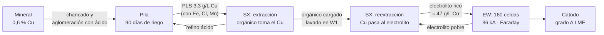
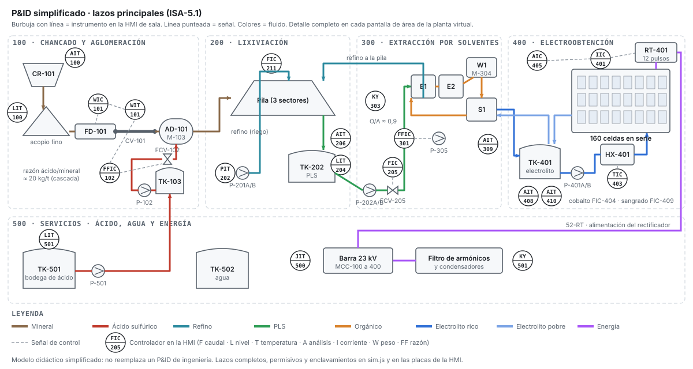
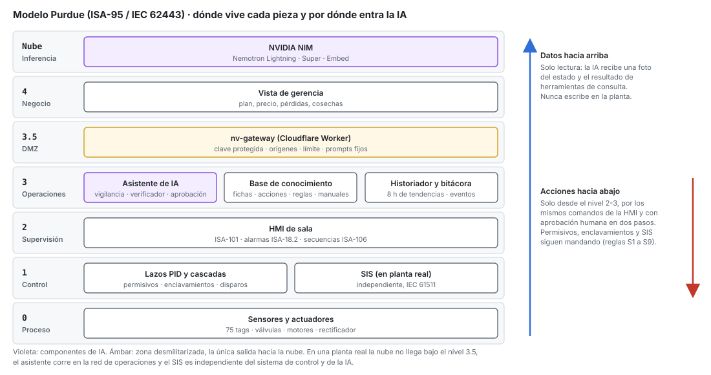
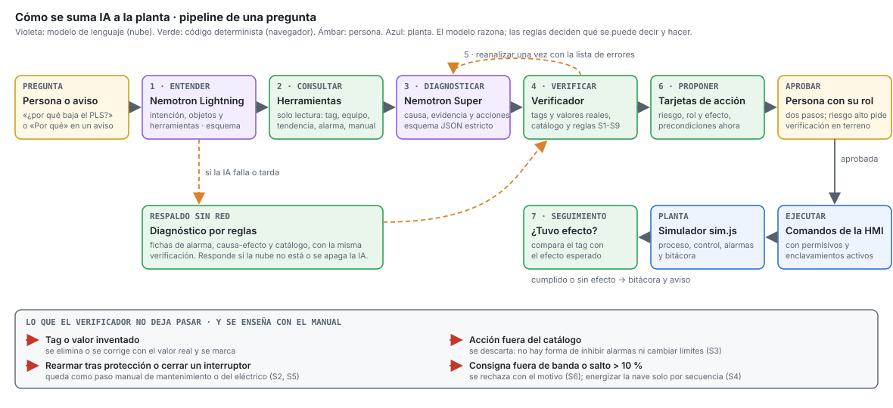
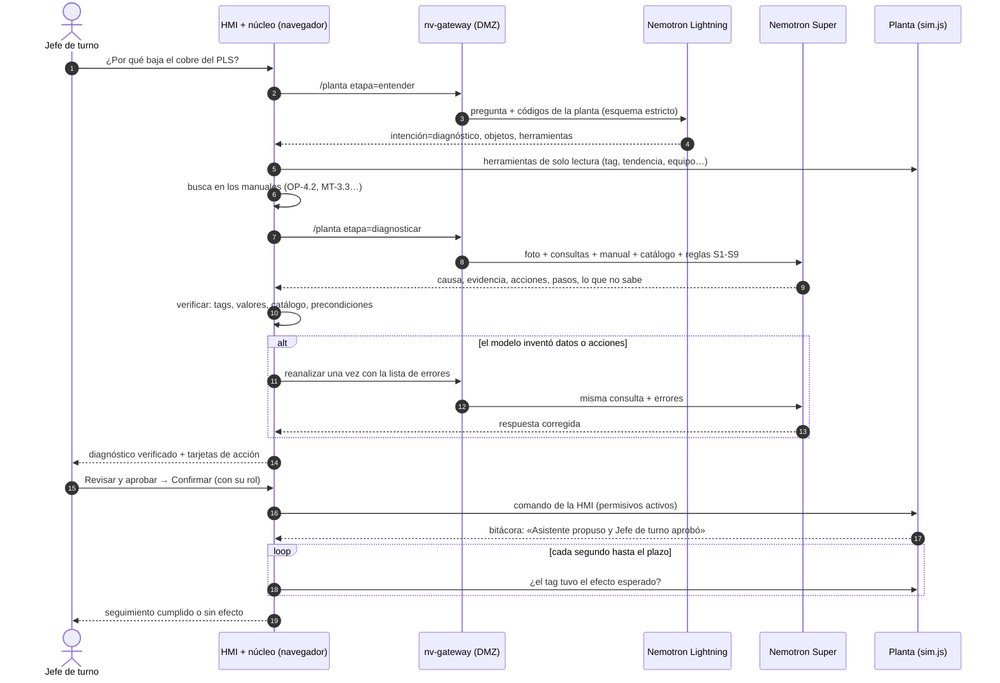
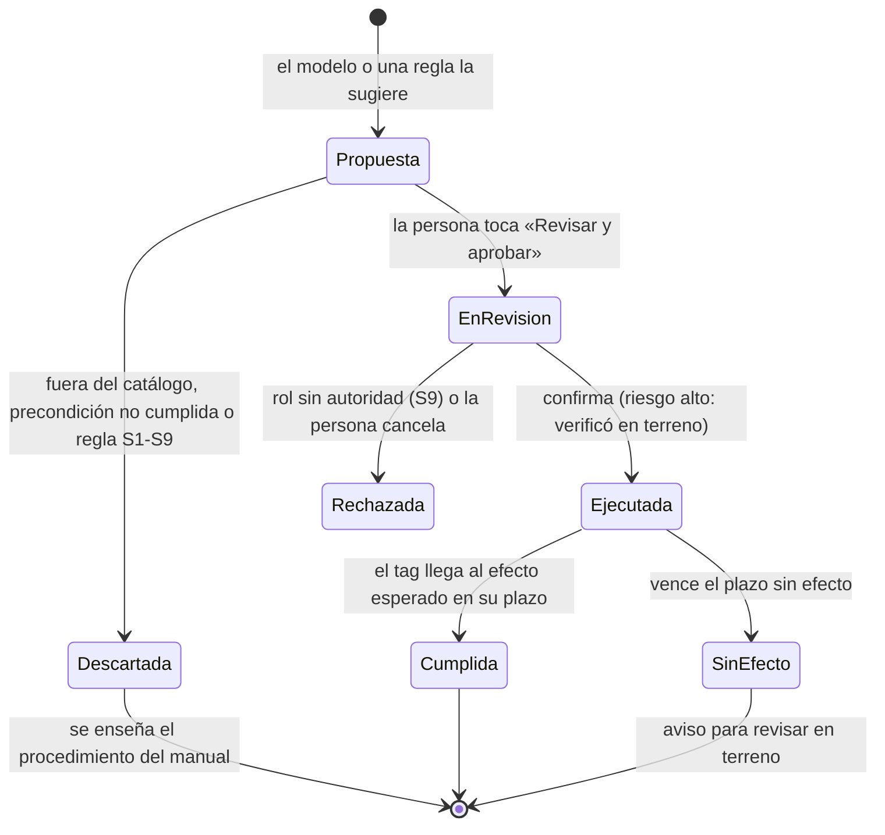

# Arquitectura · cómo se suma IA a un proceso industrial

Este documento explica la planta virtual de afuera hacia adentro: qué proceso se simula, cómo se controla, dónde vive cada pieza en el modelo Purdue y cómo un modelo de lenguaje se suma a la operación **sin tocar el control**. Está escrito para que lo entienda alguien que no es metalurgista ni programador.

## 1. El proceso en una línea

Mineral con 0,6 % de cobre entra por un lado y sale cátodo de 99,99 % por el otro. En el medio, el cobre pasa de sólido a solución, de solución a un orgánico, de vuelta a una solución pura y, con electricidad, a metal.

| Área             | Qué entra                   | Qué sale                 | Qué puede salir mal                                            | Variable que lo delata           |
| ---------------- | --------------------------- | ------------------------ | -------------------------------------------------------------- | -------------------------------- |
| 100 Aglomeración | Mineral, ácido, agua        | Glómero curado           | Revestimientos gastados, rodamiento del tambor, dosis de ácido | AIT-100 (P80), VIT-M-103, KY-102 |
| 200 Pilas        | Refino ácido                | PLS                      | Bomba de riego, pH, mineral con menos cobre                    | PIT-202, AIT-207, AIT-206        |
| 300 SX           | PLS, electrolito pobre      | Refino, electrolito rico | Borra, lavado W1 fuera                                         | AIT-309, LIT-303, AIT-410        |
| 400 EW           | Electrolito rico, corriente | Cátodo                   | Cortocircuitos, rectificador, intercambiador                   | KY-406, IIT-401, TIT-403         |
| 500 Servicios    | Energía, ácido, agua        | —                        | Interruptor abierto, stock de ácido                            | JIT-500, LIT-501, KY-501         |

El P&ID simplificado con los lazos principales:

## 2. Cómo se controla

Cada variable importante tiene un **lazo**. En el tag ISA-5.1 la primera letra dice qué se mide (F caudal, T temperatura, A análisis, I corriente) y las siguientes qué hace el instrumento (I indica, T transmite, C controla). Hay tres tipos en la planta:

- **Lazos simples:** TIC-403 mide la temperatura del electrolito y mueve la válvula de agua caliente de HX-401.
- **Razones en cascada:** FFIC-102 recibe el mineral pesado (WIT-101) y dosifica ácido para mantener 20 kg/t. Con compensación del retardo de la correa, el ácido llega cuando llega el mineral.
- **Consigna calculada:** IIC-401 recibe la corriente del plan, calculada con el balance de cobre: lo que entrega SX dividido por lo que deposita cada kA por Faraday.

Sobre los lazos están los **permisivos** (condiciones para partir), los **enclavamientos** (paradas automáticas) y las **secuencias** ISA-106 (partida y parada paso a paso). Todo eso vive en `sim.js` y la IA no lo puede saltar.

## 3. Dónde vive cada pieza: modelo Purdue

La regla de diseño es simple: **los datos suben, las acciones no bajan solas.** La IA está en el nivel 3 (operaciones). Recibe una foto del estado y el resultado de consultas de solo lectura. Cualquier acción baja por los mismos comandos que usa el operador en la HMI (nivel 2), solo con aprobación humana, y los permisivos del nivel 1 siguen mandando. En una planta real, además, el SIS es independiente de todo esto.

## 4. El pipeline de inferencia

Una pregunta recorre siete etapas. Las que razonan usan un modelo de lenguaje; las que deciden qué se puede decir y hacer son código determinista que se prueba como cualquier otro.

### Qué hace cada etapa y por qué está separada

| Etapa              | Dónde corre                                     | Por qué así                                                                                                |
| ------------------ | ----------------------------------------------- | ---------------------------------------------------------------------------------------------------------- |
| Entender           | Nemotron Lightning (30B, rápido)                | Clasificar y elegir herramientas no necesita el modelo grande. Sin red lo hace un router local.            |
| Consultar          | Navegador                                       | Las herramientas leen la planta real: el modelo no tiene que recordar ni adivinar valores.                 |
| Diagnosticar       | Nemotron Super (120B) con esquema JSON estricto | El modelo grande razona la causa. El esquema obliga a separar evidencia, acciones, pasos y lo que no sabe. |
| Verificar          | Navegador, código determinista                  | Un modelo puede inventar un tag o un valor. El verificador compara todo contra la planta y el catálogo.    |
| Reanalizar         | Nemotron Super, una vez                         | Corregir con la lista de errores mejora la respuesta; repetir sin límite solo gasta tiempo.                |
| Proponer y aprobar | Navegador + persona                             | La responsabilidad de operar es de una persona con su rol. La IA prepara la decisión.                      |
| Seguimiento        | Navegador                                       | Cerrar el ciclo: saber si la acción sirvió es lo que vuelve útil la próxima recomendación.                 |

## 5. Ciclo de vida de una acción propuesta

## 6. La base de conocimiento

El asistente no aprende de la conversación: sabe lo que está escrito y probado.

| Archivo                                       | Contenido                                                                                             | Quién lo mantiene                      |
| --------------------------------------------- | ----------------------------------------------------------------------------------------------------- | -------------------------------------- |
| `conocimiento/alarmas.json`                   | Base maestra ISA-18.2: causas, consecuencia, acción, tiempo de respuesta, acciones sugeridas y manual | Ingeniería de procesos y operación     |
| `conocimiento/acciones.json`                  | Catálogo cerrado: rol que aprueba, riesgo, objetivo, precondiciones, efecto esperado                  | Operación y seguridad                  |
| `conocimiento/reglas_fisicas.json`            | Faraday, balances de cobre y ácido, voltaje de celda, energía específica                              | Metalurgia                             |
| `conocimiento/reglas_quimicas.json`           | Rangos de operación y su porqué (Cu, ácido, Fe, Co, Cl, T, pH, carga, arrastre)                       | Metalurgia                             |
| `conocimiento/reglas_seguridad.json`          | Reglas duras S1 a S9 y riesgos por área (DS 132, DS 594, DS 43)                                       | Prevención de riesgos                  |
| `conocimiento/planta.json`                    | Áreas, corrientes, niveles Purdue y criticidad de equipos                                             | Ingeniería                             |
| `conocimiento/tags.json`, `causa_efecto.json` | Generados desde el simulador                                                                          | `herramientas/generar-conocimiento.js` |
| `manuales/*.md`                               | Operación (OP), mantenimiento (MT), gerencia (GE) y asistente (IA), en secciones citables             | Cada área                              |

Las pruebas fallan si una alarma no tiene ficha, si una ficha cita un manual inexistente, si una acción no tiene ejecutor o si un rango químico no coincide con la planta en régimen.

## 7. Cómo se evalúa

`node herramientas/evaluar-ia.mjs` provoca cada uno de los 13 escenarios de falla, pregunta «¿qué está pasando y qué hago?» y mide si la causa es la correcta, si propuso la acción esperada, si evitó la prohibida y cuánto corrigió el verificador. Con `NV_URL` apuntando al intermediario mide además el pipeline con Nemotron, para comparar prompts o modelos con la misma vara.

## 8. Cinco principios para sumar IA a una planta

1. **La IA lee, la persona decide, el control manda.** El modelo nunca escribe en el nivel 1 y cada acción tiene un responsable con nombre y rol.
2. **Lo que se puede hacer es una lista, no una conversación.** El catálogo de acciones es cerrado, con precondiciones verificables.
3. **El modelo cita, el verificador comprueba.** Toda cifra se contrasta con la planta antes de mostrarse.
4. **Sin red, la planta sigue igual y el asistente también.** El respaldo por reglas usa la misma base de conocimiento y las mismas tarjetas.
5. **Se mide como un instrumento.** Un banco de escenarios con respuesta esperada dice si un cambio de modelo o de prompt mejoró o empeoró.
